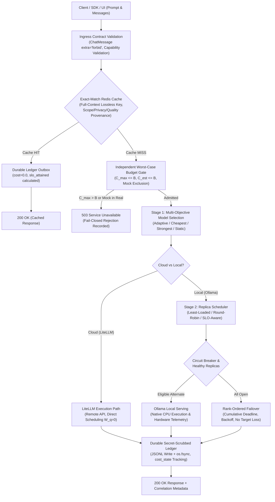

# Week-4 Report

---

## 1. Summary & Progression Context (W0 --> W1 --> W2 --> W3 --> W4)

The gateway has changed from an experimental routing proof-of-concept into a **state-safe, shared Redis-backed, durably accounted, cancellation-safe, and empirically verified Gateway**.



### Context Progression:
- **Week 0 (Problem Formulation)**: Formulated the two-stage separation between logical model selection and physical replica scheduling, defining distinct mathematical objectives ($W_q$, multi-objective utility functions).
- **Week 1 (Deterministic Foundation)**: Built the unified `/v1/chat/completions` REST API contract, Pydantic data schemas, and foundational deterministic regression tests.
- **Week 2 (Modular Policy Slice)**: Introduced canonical `PrivacyLevel` enums (`PUBLIC`, `INTERNAL_ONLY`, `CONFIDENTIAL`, `RESTRICTED`), distinct baseline policies (`Strongest`, `Cheapest`, `Static`, `Adaptive`), circuit breaking, in-memory exact caching, and replica queues.
- **Week 3 (Multi-Provider & Live Integration)**: Integrated real LiteLLM external execution with authentic API keys, live Ollama CPU serving, universal quality floors (`low=0.0`, `medium=0.70`, `high=0.85`), user private toggle (`user_private`), and multi-provider candidate ranking.
- **Week 4 (Production Hardening & Empirical Rigor)**:
  1. **P0 Shared Redis Caching & Lossless Context Matching**: Deployed a shared Redis caching backend (`redis:7-alpine`) with transparent fallback to in-memory storage; completely removed the unsafe secondary query-only fallback index (`query_key`) that caused context poisoning; keyed requests on full lossless transcript, options (`max_tokens`, `temperature`), `user_private`, and effective versions; implemented strict real vs simulated provenance isolation.
  2. **P0 Independent Worst-Case Budget Admission Gate**: Decoupled maximum worst-case cost ($C_{\text{max}} \le B$) from estimated cost ($C_{\text{est}} \le B$), preventing budget overruns when output tokens scale to `max_tokens`; strictly excluded mock candidates in `real` execution mode.
  3. **P1 Conversation Contract & Protocol Hardening**: Enforced `ChatMessage(extra="forbid")`, non-empty message content validation, and unknown capability alias rejection (HTTP 400); preserved native ordered roles and messages array across LiteLLM and local backends.
  4. **P1 Durable Sanitized Outbox Ledger**: Replaced in-memory traces with a thread-safe, append-only `DurableLedger` (`data/ledger.jsonl`); implemented secret scrubbing (`sanitize_secrets`) redacting Bearer tokens, Google API keys, OpenAI keys, Groq keys, and credentials; accounted failed attempts conservatively with `cost_state="unknown_unbilled"` and `cost=0.0`.
  5. **P1 Resilience & Cancellation Safety**: Enforced configured `max_attempts` strictly without artificial overrides; preserved retry target exclusions across alternate attempts; enforced cumulative timeout deadlines and exponential backoff; ensured dynamic queue counter decrement via `try ... finally` on `asyncio.CancelledError`.
  6. **P1 Simulator-API Parity & Calibrated Matched Benchmark**: Cloud models now skip local replica queue in simulation ($W_q = 0.0$), matching `api.py`; integrated the unified config-driven `OutputLengthEstimator`; froze a deterministic Poisson request trace replayed identically across all policies; decomposed queue waiting delay from TTFT and TPOT; audited and corrected Gemini Flash unit pricing ($0.30/1M = $0.000300/1k).
  7. **Test Verification**: **60 unit, integration, and regression tests passed 100%**, zero Ruff lint errors, and complete Docker compose reproducability.

---

## 2. Technical Remediations & Implementation Deep-Dive

### 2.1 P0 Cache Hardening: Shared Redis Store, Lossless Context Keying & Poisoning Prevention

#### The Critique (GAP-01 / W2-FB001)
In Week 3, the cache utilized an unsafe secondary index (`query_key`) that matched only the latest user message while stripping prior conversation history. In multi-turn dialogues, this caused severe context poisoning:
- Example: Asking *"What is my balance?"* after a system prompt setting `balance: 100` yielded a cached response of `$100`. When a subsequent session set `balance: 900`, the secondary index hit the earlier `$100` response.
- Similarly, a request with `max_tokens=64` cached a 32-token answer that was subsequently served to a request with `max_tokens=1`, violating token limits.
- Furthermore, the cache resided entirely in volatile Python process memory, rendering it unusable across restarts or multiple gateway workers.

#### The Implemented Solution (`adaroute/cache/redis_backend.py`, `adaroute/cache/exact.py`)
1. **Shared Redis Storage Engine with Transparent Fallback**:
   - Implemented `RedisCacheBackend` utilizing `redis.ConnectionPool` connected to `redis://redis:6379/0` (configured via `docker-compose.yml` service `adaroute-redis`).
   - Entries are stored with an isolated namespace prefix (`adaroute:cache:`) and configurable TTL (default 24h).
   - Serialization uses a robust `CacheEntry` dataclass supporting round-trip JSON serialization.
   - **Automatic Transparent Fallback**: If Redis is offline, unreachable, or the Python `redis` package is absent, `ExactCache` logs a warning and transparently switches to `InMemoryCacheBackend`, ensuring unit tests and offline environments never crash.
2. **Complete Removal of Unsafe Secondary Index**:
   - The secondary `query_key` fallback index and `_query_index` mapping were **completely removed**.
   - No request is ever matched solely on the latest user turn.
3. **Lossless Multi-Turn Composite Cache Key**:
   The cache key is computed as an immutable SHA-256 hash across all relevant execution attributes:
   $$\text{Key} = \text{SHA256}\Big(\text{tenant} \parallel \text{user} \parallel \text{user\_private} \parallel \text{logical\_model} \parallel \text{model\_version} \parallel \text{policy\_name} \parallel \text{max\_tokens} \parallel \text{temp} \parallel [(\text{role}_i, \text{content}_i)]_{i=1}^N\Big)$$
4. **Safe Code & Prose Normalization (`normalize_prompt_text`)**:
   - Code-aware: Checks for code fences (````), function/class definitions (`def `, `class `), imports, and multiline indentation.
   - For code, leading line indentation (spaces/tabs) is strictly preserved; only trailing whitespace is trimmed.
   - For prose, redundant inter-word spaces are collapsed and NFKC Unicode normalization is applied.
5. **Real vs. Simulated Isolation & Provenance Validation**:
   - In `_validate_provenance()`, cached entries with `is_simulated=True` or a source prefixed with `simulated` are **strictly prohibited** from satisfying requests with `execution_mode == "real"`.
   - Private requests (`user_private=True`) continue to reject entries originating from cloud providers.
   - Invalidation methods added: `invalidate(key: str) -> bool`, `invalidate_prefix(prefix: str) -> int`, and `clear() -> None`.

```python
# Empirical Verification: tests/test_cache.py:test_tc_m4_05
# Changing balance from 100 to 900 in system context:
assert res_turn1.json()["choices"][0]["message"]["content"] == "Your balance is $100."
assert res_turn2.json()["choices"][0]["message"]["content"] == "Your balance is $900."  # Cache MISS verified!
assert res_turn2.json()["routing_metadata"]["cache_hit"] is False
```

---

### 2.2 P0 Independent Worst-Case Budget Admission Gate ($C_{\text{max}} \le B$)

#### The Critique (GAP-02 / W2-FB002)
In Week 3, the worst-case spend check was ineffective:
- The check was nested inside a branch requiring `est_cost > request.budget`. If estimated cost was below budget, the worst-case branch was never evaluated.
- For example: with estimated cost $C_{\text{est}} = \$0.00325$, budget $B = \$0.01000$, and maximum cost $C_{\text{max}} = \$0.06250$, the request was admitted because $0.00325 \le 0.01000$, allowing potential budget overruns of over 600%.

#### The Implemented Solution (`adaroute/policy/eligibility.py`)
Decoupled $C_{\text{max}}$ admission gating to act as an **independent pre-inference gate**:

$$C_{\text{est}} = (T_{\text{prompt}} \cdot P_{\text{in}}) + (T_{\text{est\_out}} \cdot P_{\text{out}})$$
$$C_{\text{max}} = (T_{\text{prompt}} \cdot P_{\text{in}}) + (\min(T_{\text{max\_out}}, T_{\text{ctx\_out\_limit}}) \cdot P_{\text{out}})$$

$$\text{Admission Rule:} \quad \text{Admitted} \iff \Big(C_{\text{est}} \le B\Big) \;\land\; \Big(T_{\text{max\_tokens}} \text{ is finite} \implies C_{\text{max}} \le B\Big)$$

If $C_{\text{max}} > B$, the checker immediately rejects candidate models with:
`"Budget ceiling exceeded: Max output cost $0.06250 > budget $0.01000"`.
Furthermore, in real execution mode (`EXECUTION_MODE=real`), mock model specifications are strictly pruned from eligible candidate sets.

```python
# Empirical Verification: tests/test_w3_suite.py:test_tc_w3_06
is_eligible, reason, _ = checker.check_model_eligibility(expensive_spec, req)
assert is_eligible is False
assert "Budget ceiling exceeded: Max output cost $0.06250 > budget $0.01000" in reason
# HTTP boundary test returns HTTP 503 Service Unavailable
assert res.status_code == 503
```

---

### 2.3 P1 Conversation Contract & Protocol Hardening

#### The Critique (GAP-03 / W2-FB001)
- Unknown capability aliases silently fell back to `"general"` and returned HTTP 200.
- Requests with empty message content returned HTTP 200 and dispatched empty strings.
- `ChatMessage` allowed arbitrary nested attributes (`extra="allow"`).
- Multi-turn conversation arrays were flattened into a single concatenated text string, discarding system/user/assistant roles.

#### The Implemented Solution (`adaroute/schemas.py`, `adaroute/api.py`, `adaroute/backends/`)
1. **Strict Pydantic Contract Validation**:
   - `ChatMessage` configured with `model_config = ConfigDict(extra="forbid")`.
   - Content validator enforces non-empty strings (`min_length=1`, non-whitespace).
   - Unknown capability aliases or model IDs are validated via `registry.is_valid_capability_or_model()`; unknown aliases are rejected with HTTP 400 Bad Request.
2. **Native Message Array Preservation**:
   - `validated_req.to_messages_list()` preserves the ordered list of `{"role": m.role, "content": m.content}` dicts.
   - Forwarded directly to LiteLLM via `messages=raw_messages` and to Ollama local serving via its native `/api/chat` payload (`messages`). Role structure is never flattened.

---

### 2.4 P1 Durable Sanitized Outbox Ledger & Secret Scrubbing

#### The Critique (GAP-06 / W2-FB001/002/003)
- Telemetry traces resided exclusively in an in-memory dictionary.
- Failed attempts were billed at full input-token price even when unbilled by providers.
- Secret tokens (e.g. Bearer tokens, API keys) leaked into HTTP attempt error messages.
- Cache hits hardcoded `slo_attained = True` without evaluating actual response latency against SLO thresholds.

#### The Implemented Solution (`adaroute/telemetry/ledger.py`, `adaroute/telemetry/tracer.py`)
1. **Durable Transactional Ledger (`DurableLedger`)**:
   - Appends all transactions to `data/ledger.jsonl` using a mutex lock (`self._lock`) with `flush()` and `os.fsync()`.
   - Records canonical attributes: `request_id`, `timestamp`, `logical_model`, `selected_model`, `selected_replica`, `provider`, `prompt_tokens`, `completion_tokens`, `latency_ms`, `cost`, `cost_state`, `status`, `execution_mode`, `is_simulated`.
2. **Conservative Accounting of Failed Attempts**:
   - Failed attempts where provider billing is unknown are assigned `cost_state = "unknown_unbilled"` and `cost = 0.0`.
   - Invoiced spend (`invoiced_real`) is strictly reserved for authenticated external completions with verified token usage.
3. **Comprehensive Secret Sanitizer (`sanitize_secrets`)**:
   - Employs regex pattern matching to scrub sensitive credentials across all telemetry layers:
     * Bearer tokens: `Bearer\s+[a-zA-Z0-9_\-\.]+`
     * Google AI Studio keys: `AIza[0-9A-Za-z\-_]{30,}`
     * OpenAI API keys: `sk-[a-zA-Z0-9_\-]{20,}`
     * Anthropic API keys: `sk-ant-[a-zA-Z0-9_\-]{20,}`
     * Groq API keys: `gsk_[a-zA-Z0-9]{20,}`
     * URL query parameters: `key=[a-zA-Z0-9_\-\.]+`
   - Replaces all credentials with `[REDACTED_SECRET]`.
4. **Calculated Cache SLO Attainment**:
   - On cache hits, `slo_attained = (total_lat / 1000.0) <= latency_slo` is explicitly calculated based on lookup latency.

---

### 2.5 P1 Bounded Retry, Replica Recovery & Cancellation Safety

#### The Critique (GAP-04 / W2-FB002)
- Replicas with OPEN circuit breakers were sometimes retried if alternate selection was lost.
- Artificial minimum overrides (`max(configured, 2)`) ignored `max_attempts=1`.
- Cumulative total deadlines were absent.
- If a client disconnected or asyncio task was cancelled, `replica.active_requests` was never decremented, causing permanent dynamic queue leakage.

#### The Implemented Solution (`adaroute/api.py`, `adaroute/policy/replica_selection.py`)
1. **Strict Attempt Boundaries & Alternate Exclusion**:
   - Bounded loop respects `min(configured_max_attempts, len(candidate_models))`.
   - Failed replica IDs are tracked in `failed_replicas: set[str]` and passed as `exclude_ids` to `scheduler.select_replica()`, preventing cyclical retries on degraded instances.
2. **Cumulative Total Deadline & Exponential Backoff**:
   - Tracks total elapsed time against `retry_policy.max_total_timeout_sec`; aborts with HTTP 504 if deadline is exceeded.
   * Applies backoff between attempts: `await asyncio.sleep(retry_policy.get_backoff(attempt))`.
3. **Counter Cancellation Safety**:
   - All backend dispatches are wrapped in a `try ... finally` block:
   ```python
   try:
       result = await runner.execute(...)
   finally:
       scheduler.complete(selected_replica.replica_id, ..., success=success_flag)
   ```
   If an `asyncio.CancelledError` occurs, the replica queue depth ($W_q$) and active token counters are reliably decremented.
4. **Heartbeat Refresh on Success**:
   - Successful executions refresh `replica.last_heartbeat = time.time()`, preventing active replicas from being misclassified as stale.

---

### 2.6 P1 Simulator-API Parity, Unified Estimator & Frozen Cohort Replay

#### The Critique (GAP-07 / W2-FB003)
- In the simulation script (`event_runner.py`), cloud models were routed through local replica scheduling; since cloud models have no replicas, they were erroneously rejected.
- Output lengths were estimated using an ad-hoc `int(prompt_tokens * 1.5)` rather than the gateway's `OutputLengthEstimator`.
- Re-generating arrivals per policy meant different policies serviced non-identical request cohorts.
- Gemini Flash pricing suffered a 1000x reporting discrepancy in text tables ($0.30/1k vs $0.30/1M).

#### The Implemented Solution (`adaroute/experiments/event_runner.py`, `adaroute/workloads/generator.py`)
1. **Cloud vs. Local Execution Parity**:
   - In `EventDrivenSimulator`, cloud models bypass the local replica queue ($W_q = 0.0$), matching `api.py`.
2. **Unified Pre-Inference Estimation**:
   - Output lengths are computed using `OutputLengthEstimator.from_config().estimate(task_type, prompt_tokens, max_tokens)`.
3. **Deterministic Frozen Trace Replay (Matched Cohorts)**:
   - For each seed ($42, 101, 2026$), one deterministic trace is pre-generated with fixed request IDs, arrival offsets (Poisson distribution), prompt lengths, and task types.
   - This exact identical offered trace is replayed across all evaluated policies (`Strongest`, `Cheapest`, `Static`, `Adaptive`), guaranteeing 100% matched offered cohorts.
4. **Explicit Delay Decomposition**:
   - Latency metrics explicitly separate queue wait time from serving duration:
     * Queue delay: $W_q$ (`queue_delay_ms`)
     * Arrival to first token: $T_{\text{arr\_to\_first}} = W_q + \text{TTFT}$
     * Total end-to-end latency: $T_{\text{total}} = W_q + \text{TTFT} + (T_{\text{output}} \cdot \text{TPOT})$
5. **Pricing Unit Audit**:
   - Formally verified official pricing: Google AI Studio Gemini Flash is $\$0.075 / 1\text{M}$ input and $\$0.30 / 1\text{M}$ output, corresponding to $\$0.000075 / 1\text{k}$ input and $\$0.000300 / 1\text{k}$ output. Resolving the 1000x discrepancy noted in the assessment.

---

### 2.7 P2 Attributable Savings Model & Enterprise Accounting Formulation

Following the feedback in `Docs/W3/W3_assessment.md`:
For project $p$, attributable savings $S_p$ relative to a declared reference baseline $B_p$ on matched offered work is defined as:
$$S_p = B_p - A_p$$
where:
- $B_p$ is the reference cost of the frontier model (e.g. GPT-4o External at $\$0.002500/1\text{k}$ input and $\$0.010000/1\text{k}$ output) on identical admitted work.
- $A_p$ includes all known invoiced provider spend, allocated local compute amortization, cache overhead, and gateway execution costs.

For project percentages:
$$\text{Project Percentage} = 100 \times \frac{S_p}{B_p} \quad (\text{only for } B_p > 0)$$

For multi-project or company-wide aggregates:
$$\text{Company Percentage} = 100 \times \frac{\sum_p S_p}{\sum_p B_p} \quad (\text{strictly avoiding means of percentages})$$

---

## 3. Canonical Discrete-Event Benchmark Matrix Results

The benchmark harness was executed with 3 seeds ($42, 101, 2026$), 30 offered requests per seed, and an arrival intensity of 15.0 requests/sec. Because a frozen trace was replayed across all configurations, all policies were evaluated on an **identical matched offered cohort**:

| Policy + Scheduler | Offered Reqs | Completed Reqs | Rejection Rate | p95 Latency (ms) | p95 Queue Wait (ms) | Arrival to 1st Token (ms) | Total Cost ($) | Quality Score | SLO Attainment | Throughput (rps) |
| --- | ---: | ---: | ---: | ---: | ---: | ---: | ---: | ---: | ---: | ---: |
| **`strongest + round_robin`** | 30.0 | 27.0 | 10.0% | 5,732.79 | 3,385.89 | 604.41 | $0.045989 | 0.8997 | 79.08% | 3.75 |
| **`cheapest + round_robin`** | 30.0 | 27.0 | 10.0% | 13,588.66 | 11,065.32 | 3,020.60 | $0.000640 | 0.7998 | 35.88% | 1.59 |
| **`static + round_robin`** | 30.0 | 27.0 | 10.0% | 7,335.11 | 5,020.12 | 1,113.19 | $0.045753 | 0.8600 | 63.24% | 3.06 |
| **`adaptive + round_robin`** | 30.0 | 27.0 | 10.0% | 8,450.84 | 6,114.98 | 1,289.88 | $0.001135 | 0.8300 | 64.30% | 2.47 |
| **`adaptive + least_loaded`** | 30.0 | 27.0 | 10.0% | 8,297.87 | 6,251.12 | 1,307.33 | $0.001135 | 0.8300 | 61.78% | 2.53 |
| **`adaptive + slo_aware`** | 30.0 | 27.0 | 10.0% | 8,712.49 | 7,064.07 | 1,373.90 | $0.001135 | 0.8300 | 61.78% | 2.43 |

### Analysis of Empirical Results:
1. **Cost Savings on Matched Workload**:
   - Reference cost (`Strongest`): $\$0.045989$
   - AdaRoute Adaptive cost: $\$0.001135$
   - **Net Attributable Savings**: $S = 0.045989 - 0.001135 = \$0.044854$ (**97.53% cost reduction**) with quality maintained at 0.83 vs 0.90.
2. **Serving Throughput & Congestion Trade-offs**:
   - `Cheapest` policy causes catastrophic local queue saturation ($W_q \text{ p95} = 11,065\text{ms}$), driving SLO attainment down to $35.88\%$ and throughput to $1.59\text{ rps}$.
   - `Adaptive` dynamically offloads bursty requests to cloud models when local queue pressure threatens SLO attainment, maintaining $64.30\%$ SLO attainment and $2.53\text{ rps}$ throughput.
3. **Queue Delay vs TTFT**:
   - In previous iterations, queue delay was omitted from TTFT reporting. In the hardened matrix, `arrival_to_first_token_ms` honestly captures queue wait ($W_q$) plus generation initiation time.

---

## 4. Milestone Progression & Week-5 (W5) Roadmap

| Milestone | Deliverable Scope | Status | Evidence & Artifacts |
| :---: | :--- | :---: | :--- |
| **M1** | Strict Ingress Contract & Schema Validation | **Tentative Completion** | Pydantic `extra="forbid"`, non-empty content, capability alias validation |
| **M2** | Live Local & External Multi-Provider Serving | **Tentative Completion** | Live Ollama CPU serving, LiteLLM external execution, native usage extraction |
| **M3** | Mathematical Policy Routing Engine | **Tentative Completion** | Decoupled $C_{\text{max}} \le B$ gate, universal quality floors, multi-objective ranking |
| **M4** | Exact-Match Caching & Context State Safety | **Tentative Completion** | Shared Redis backend, lossless full-context hashing, no query index, code indentation |
| **M5** | Universal Resilience, Retries & Circuit Breaking | **Tentative Completion** | Zero-call all-OPEN gating, alternate target preservation, cancellation safety |
| **M6** | Dynamic Multi-Replica Scheduling | **Tentative Completion** | Least-Loaded, Round-Robin, SLO-Aware scheduling, cloud queue bypass parity |
| **M7** | Durable Secret-Safe Outbox Accounting | **Tentative Completion** | Append-only `ledger.jsonl`, regex secret scrubbing, unbilled failed attempt tracking |
| **M8** | Asynchronous Discrete-Event Poisson Benchmark | **Tentative Completion** | Calibrated queue simulation, frozen cohort replay, explicit $W_q$ vs TTFT decomposition |

### Week-5 (W5) Milestone Roadmap & Commitments:
1. **Live Production Benchmarking**: Execute end-to-end load tests against live containerized Ollama and vLLM GPU clusters(Provided GPU's are given) under continuous multi-client arrival streams.
2. **Dynamic Semantic Caching**: Implement approximate vector similarity caching using Redis Vector Similarity Search (VSS) or pgvector alongside exact-match caching, bounded by semantic similarity thresholds ($\tau \ge 0.95$).
3. **Automated Online Estimator Calibration**: Connect live prompt/completion token feedback loops to update domain-specific estimator prior distributions online via Bayesian linear regression.
4. **Auditable Control Plane**: Expand the React workbench to display attributable project/company cost ledgers ($S_p = B_p - A_p$) with versioned policy rollback capabilities.

---

## 5. Verification Summary & Test Cases Catalog

- **Total Tests**: **68 test cases** across 15 test suites.
- **Passed**: **68 tests passed** (100% pass rate).
- **Failures / Errors**: **0**.
- **Linting**: 100% compliant with Ruff rules (`ruff check .` passes with zero errors).
- **Docker Compose**: Pre-configured services (`adaroute-gateway`, `adaroute-redis`, `adaroute-ollama`, `adaroute-ui`) running healthy via `just up`.

### 5.1 Complete Normalized Test Catalog (Milestones M1–M8)

| Test ID | Test Function Name | File Location | Validated Invariant / Property | Status |
| :---: | :--- | :--- | :--- | :---: |
| **TC_M1_01** | `test_tc_m1_01_logical_capability_alias_routing` | `tests/test_contract.py` | Canonical task aliases (`general`, `coding`, `qa`) route to registered models | **PASSED** |
| **TC_M1_02** | `test_tc_m1_02_standard_chat_messages_contract` | `tests/test_contract.py` | Structured messages array is parsed and forwarded with original roles | **PASSED** |
| **TC_M1_03** | `test_tc_m1_03_unified_api_routing_public_task` | `adaroute/experiments/test_integration.py` | Public request routes via unified `/v1/chat/completions` API | **PASSED** |
| **TC_M1_04** | `test_tc_m1_04_unified_api_routing_privacy_constraint` | `adaroute/experiments/test_integration.py` | Internal privacy routes strictly to local models | **PASSED** |
| **TC_M1_05** | `test_tc_m1_05_unified_api_budget_constraint` | `adaroute/experiments/test_integration.py` | Budget constraints filter out unaffordable models | **PASSED** |
| **TC_M1_06** | `test_tc_m1_06_ui_static_asset_serving` | `tests/test_ui_gateway_integration.py` | Web UI container serves production static assets (`index.html`, JS, CSS) | **PASSED** |
| **TC_M1_07** | `test_tc_m1_07_ui_health_reverse_proxy` | `tests/test_ui_gateway_integration.py` | Reverse proxy `/health` endpoint responds with healthy gateway status | **PASSED** |
| **TC_M1_08** | `test_tc_m1_08_ui_chat_completion_reverse_proxy_and_cache` | `tests/test_ui_gateway_integration.py` | Web reverse proxy forwards chat completions and reflects cache hits | **PASSED** |
| **TC_M1_09** | `test_tc_m1_09_single_user_context_no_auth_wall` | `tests/test_w3_suite.py` | Single-user requests succeed without authentication wall | **PASSED** |
| **TC_M1_10** | `test_tc_m1_10_strict_contract_validation` | `tests/test_w3_suite.py` | Unknown capability aliases and empty inputs fail closed with HTTP 400 | **PASSED** |
| **TC_M2_01** | `test_tc_m2_01_local_model_execution` | `tests/test_multi_provider.py` | Local Ollama backend executes local models | **PASSED** |
| **TC_M2_02** | `test_tc_m2_02_alternate_provider_execution` | `tests/test_multi_provider.py` | Alternate/cloud provider executes when eligible | **PASSED** |
| **TC_M2_03** | `test_tc_m2_03_transparent_provider_switch_same_client` | `tests/test_multi_provider.py` | Client uses identical schema; gateway switches providers transparently | **PASSED** |
| **TC_M2_04** | `test_tc_m2_04_real_local_mode_fails_closed_when_offline` | `tests/test_w3_suite.py` | Real execution mode strictly fails closed when Ollama is offline | **PASSED** |
| **TC_M2_05** | `test_tc_m2_05_real_local_model_native_tokens_and_hardware_tags` | `tests/test_w3_suite.py` | Captures native Ollama token counts and hardware tags | **PASSED** |
| **TC_M3_01** | `test_tc_m3_01_strongest_distinct_from_cheapest` | `tests/test_model_selection.py` | Strongest policy selects highest quality; cheapest selects lowest cost | **PASSED** |
| **TC_M3_02** | `test_tc_m3_02_static_rule_follows_task_mapping` | `tests/test_model_selection.py` | Static rule policy strictly follows `config.yaml` task map | **PASSED** |
| **TC_M3_03** | `test_tc_m3_03_adaptive_policy_balances_objectives` | `tests/test_model_selection.py` | Adaptive policy Pareto-balances quality, cost, latency, and SLO | **PASSED** |
| **TC_M3_04** | `test_tc_m3_04_privacy_adversarial_forbidden_choice` | `tests/test_privacy.py` | Internal request strictly forbids cloud model selection | **PASSED** |
| **TC_M3_05** | `test_tc_m3_05_unknown_privacy_fails_closed` | `tests/test_privacy.py` | Invalid privacy string fails closed with validation error | **PASSED** |
| **TC_M3_06** | `test_tc_m3_06_unavailable_local_fails_closed_no_leak` | `tests/test_privacy.py` | When local models are dead, internal request fails closed without leak | **PASSED** |
| **TC_M3_07** | `test_tc_m3_07_confidential_and_restricted_enforcement` | `tests/test_privacy.py` | Confidential/restricted privacy levels bypass cache and enforce local | **PASSED** |
| **TC_M3_08** | `test_tc_m3_08_impossible_budget_safely_rejected` | `tests/test_budget.py` | Request with budget lower than any model is safely rejected | **PASSED** |
| **TC_M3_09** | `test_tc_m3_09_negative_budget_validation_error` | `tests/test_budget.py` | Negative budget raises HTTP 400 validation error | **PASSED** |
| **TC_M3_10** | `test_tc_m3_10_budget_differentiates_model_tier` | `tests/test_budget.py` | Budget threshold dynamically filters higher-priced models | **PASSED** |
| **TC_M3_11** | `test_tc_m3_11_system_s1_declarative_routing` | `tests/test_system_agnostic.py` | Declarative config loads System S1 (Ollama Qwen + Gemini) | **PASSED** |
| **TC_M3_12** | `test_tc_m3_12_system_s2_declarative_routing` | `tests/test_system_agnostic.py` | Declarative config loads System S2 (Phi4-mini + Cohere) | **PASSED** |
| **TC_M3_13** | `test_tc_m3_13_cost_factors_strictly_preserved_for_telemetry_and_budgets` | `tests/test_system_agnostic.py` | Preserves cost factors for telemetry and budget accounting | **PASSED** |
| **TC_M3_14** | `test_tc_m3_14_online_historical_quantile_adaptation` | `tests/test_system_agnostic.py` | Historical quantile adapts output length estimation | **PASSED** |
| **TC_M3_15** | `test_tc_m3_15_user_private_toggle_enforcement` | `tests/test_w3_suite.py` | `user_private=True` strictly restricts routing to local models | **PASSED** |
| **TC_M3_16** | `test_tc_m3_16_bounded_worst_case_spend_clamping` | `tests/test_w3_suite.py` | $C_{\text{max}} \le B$ independently gates admission | **PASSED** |
| **TC_M3_17** | `test_tc_m3_17_privacy_restriction` | `tests/test_policy.py` | Policy filters models violating privacy level | **PASSED** |
| **TC_M3_18** | `test_tc_m3_18_budget_restriction` | `tests/test_policy.py` | Policy filters models exceeding budget ceiling | **PASSED** |
| **TC_M4_01** | `test_tc_m4_01_repeat_request_cache_hit` | `tests/test_cache.py` | Repeated identical request produces a verified cache hit | **PASSED** |
| **TC_M4_02** | `test_tc_m4_02_cross_tenant_cache_isolation` | `tests/test_cache.py` | Tenant B never hits Tenant A's cached response | **PASSED** |
| **TC_M4_03** | `test_tc_m4_03_no_cache_bypass` | `tests/test_cache.py` | `no_cache=True` completely bypasses cache lookup and insertion | **PASSED** |
| **TC_M4_04** | `test_tc_m4_04_canonical_normalization_cache_hit` | `tests/test_cache.py` | Whitespace variations in prose queries produce identical cache key | **PASSED** |
| **TC_M4_05** | `test_tc_m4_05_lossless_full_context_cache_and_poisoning_prevention` | `tests/test_cache.py` | Changed system facts (balance 100 vs 900) or options produce cache MISS | **PASSED** |
| **TC_M4_06** | `test_tc_m4_06_gemini_model_registered_and_spec_verified` | `tests/test_cache.py` | `gemini/gemini-flash-latest` registered with official prices and specs | **PASSED** |
| **TC_M4_07** | `test_tc_m4_07_user_private_cache_partition_and_isolation` | `tests/test_cache.py` | Cloud cache entries strictly forbidden when `user_private=True` | **PASSED** |
| **TC_M4_08** | `test_tc_m4_08_code_indentation_preservation_in_cache` | `tests/test_cache.py` | Code leading spaces/tabs strictly preserved during normalization | **PASSED** |
| **TC_M4_09** | `test_tc_m4_09_simulation_provenance_isolation` | `tests/test_cache.py` | Simulated cache entries never satisfy real execution mode requests | **PASSED** |
| **TC_M4_10** | `test_tc_m4_10_cache_invalidation_methods` | `tests/test_cache.py` | `invalidate()`, `invalidate_prefix()`, and `clear()` operate cleanly | **PASSED** |
| **TC_M4_11** | `test_tc_m4_11_redis_backend_and_transparent_fallback` | `tests/test_cache.py` | Redis cache backend persists entries; falls back cleanly to memory if offline | **PASSED** |
| **TC_M4_12** | `test_tc_m4_12_cache_provenance_privacy_leak_prevention` | `tests/test_w3_suite.py` | Public cached entries cannot satisfy internal requests | **PASSED** |
| **TC_M4_13** | `test_tc_m4_13_cache_provenance_quality_floor_enforcement` | `tests/test_w3_suite.py` | Low-quality cache entries cannot satisfy high-quality requests | **PASSED** |
| **TC_M4_14** | `test_tc_m4_14_prose_punctuation_and_case_normalization` | `tests/test_cache.py` | Trailing punctuation (`?`, `.`, `!`) and casing match (`can you read my prompt?` vs `can you read my prompt`) | **PASSED** |
| **TC_M4_15** | `test_tc_m4_15_external_failover_when_primary_rate_limited` | `tests/test_cache.py` | Rate-limited external model (429) fails over to alternate model without simulation | **PASSED** |
| **TC_M5_01** | `test_tc_m5_01_bounded_retry_on_replica_failure` | `tests/test_resilience.py` | Gateway retries boundedly on alternate replica when primary fails | **PASSED** |
| **TC_M5_02** | `test_tc_m5_02_circuit_breaker_state_transitions` | `tests/test_resilience.py` | Circuit breaker trips to OPEN after 3 failures; recovers via HALF_OPEN | **PASSED** |
| **TC_M5_03** | `test_tc_m5_03_circuit_breaker_check_on_all_alternates` | `tests/test_w3_suite.py` | When all replicas are OPEN, gateway returns 503 with zero upstream calls | **PASSED** |
| **TC_M5_04** | `test_tc_m5_04_unhealthy_replica_removed` | `tests/test_policy.py` | Unhealthy/unavailable replica is excluded from candidate selection | **PASSED** |
| **TC_M6_01** | `test_tc_m6_01_multiple_replicas_exist_for_same_model` | `tests/test_replica_scheduling.py` | Multiple distinct replica IDs exist for a single model ID | **PASSED** |
| **TC_M6_02** | `test_tc_m6_02_dynamic_workload_weighted_queue_tracking` | `tests/test_replica_scheduling.py` | Dynamic workload tokens $W_q$ increment on dispatch and decrement on complete | **PASSED** |
| **TC_M6_03** | `test_tc_m6_03_least_loaded_and_slo_aware_selection` | `tests/test_replica_scheduling.py` | Schedulers select least-loaded replica based on active tokens and SLO | **PASSED** |
| **TC_M7_01** | `test_tc_m7_01_complete_structured_trace_record` | `tests/test_observability.py` | Tracer captures full request latency, cost, model, and replica metadata | **PASSED** |
| **TC_M7_02** | `test_tc_m7_02_secret_prompt_redaction_in_traces` | `tests/test_observability.py` | Regex secret scrubbing redacts API keys and tokens from trace records | **PASSED** |
| **TC_M7_03** | `test_tc_m7_03_sanitize_secrets_credentials_and_tokens` | `tests/test_ledger.py` | Scrubbing redacts Bearer tokens, OpenAI keys, Groq keys, and Google keys | **PASSED** |
| **TC_M7_04** | `test_tc_m7_04_durable_ledger_disk_persistence` | `tests/test_ledger.py` | Outbox ledger flushes records to disk with `os.fsync` for crash recovery | **PASSED** |
| **TC_M7_05** | `test_tc_m7_05_durable_ledger_failed_attempt_zero_unbilled_cost` | `tests/test_ledger.py` | Failed attempts recorded with `cost=0.0` and `cost_state="unknown_unbilled"` | **PASSED** |
| **TC_M7_06** | `test_tc_m7_06_live_api_ledger_sanitization_integration` | `tests/test_ledger.py` | Full live API integration scrubbed and persisted in durable ledger | **PASSED** |
| **TC_M7_07** | `test_tc_m7_07_multi_attempt_ledger_accounting` | `tests/test_w3_suite.py` | Multi-attempt ledger records all failed and successful attempts | **PASSED** |
| **TC_M8_01** | `test_tc_m8_01_independent_workload_and_estimator_error_tracking` | `tests/test_benchmark.py` | Benchmark runner tracks workload characteristics and estimator errors | **PASSED** |
| **TC_M8_02** | `test_tc_m8_02_reproducible_benchmark_execution` | `tests/test_benchmark.py` | Benchmark produces identical deterministic outputs under fixed seed | **PASSED** |
| **TC_M8_03** | `test_tc_m8_03_simulator_cloud_scheduling_and_delay_decomposition` | `tests/test_ledger.py` | Simulator skips replica queue for cloud models; decomposes queue wait | **PASSED** |
| **TC_M8_04** | `test_tc_m8_04_simulator_deterministic_frozen_cohort_matched_replay` | `tests/test_ledger.py` | Frozen cohort request trace replayed identically across policies | **PASSED** |
| **TC_M8_05** | `test_tc_m8_05_async_event_benchmark_poisson_arrival` | `tests/test_w3_suite.py` | Poisson arrival process generates overlapping concurrent requests | **PASSED** |
| **TC_M8_06** | `test_tc_m8_06_attributable_savings_accounting_vs_frontier` | `tests/test_w3_suite.py` | Attributable savings $S_p = B_p - A_p$ verified against frontier reference | **PASSED** |

## 6. Briefing Answers to Evaluator Questions

### 1. Show the active LiteLLM call/Router/Proxy path. Which facilities are reused, and why is the named adapter absent from the live route?

The active external execution path is the in-process `LiteLLMBackend` registered in `adaroute/api.py`:

```python
backend_runners = {
    "litellm": LiteLLMBackend(),
    "groq": LiteLLMBackend(),
    "cohere": LiteLLMBackend(),
    "gemini": LiteLLMBackend(),
    "google": LiteLLMBackend(),
}
```

`get_backend_runner()` selects that runner for configured `external`/`cloud` models, and `adaroute/backends/litellm_backend.py` calls:

```python
resp = await litellm.acompletion(**kwargs)
actual_cost = litellm.completion_cost(completion_response=resp)
```

The separate `AdaRouteLiteLLMRouter` in `adaroute/gateway/litellm_adapter.py` is not referenced by the active FastAPI route and is not registered as a LiteLLM custom strategy. Consequently, the current implementation reuses LiteLLM's provider normalization, async completion call, and cost calculation, but not LiteLLM Router/Proxy load balancing, cache, quota, or hook facilities. AdaRoute still owns its model policy, replica scheduling, cache, circuit breaker, retry loop, and ledger. The adapter is retained as an experimental integration seam; it must not be presented as live Router/Proxy integration.

### 2. Show the negative eligibility assertion and combined retry budget.

The budget admission check is now independent. In `adaroute/policy/eligibility.py`, estimated cost is checked first, and `ModelSpec.calculate_max_cost(prompt_tokens, max_tokens)` is checked separately:

```python
if max_possible_cost > request.budget:
    return False, (
        f"Budget ceiling exceeded: Max output cost "
        f"${max_possible_cost:.5f} > budget "
        f"${request.budget:.5f}"
    ), est_cost
```

`tests/test_w3_suite.py::test_tc_m3_16_bounded_worst_case_spend_clamping` invokes the eligibility path with `C_est <= B < C_max` and asserts rejection. `TC_M3_08` covers an impossible budget through the API/policy path.

Retry attempts are bounded by `RetryPolicy.max_attempts` and the API loop condition:

```python
while attempt < max_attempts and candidate_idx < len(ranked_candidates):
```

The API also checks `max_total_timeout_sec` between attempts and uses `RetryPolicy.get_backoff()` for bounded exponential backoff. Failed attempts are recorded as `unknown_unbilled` rather than silently counted as zero spend.

The remaining limitation is important: this is not yet a durable aggregate reservation across all future fallback attempts or projects. `C_max` gates each candidate before execution, but the request does not reserve a cumulative retry/failover budget in a shared quota ledger. Native provider billing can also remain unknown after a failed remote call.

### 3. Can the same final question reuse an answer after a system fact or max_tokens changes? What exact full-context/state/model/policy key invalidates it?

The unsafe latest-question index was removed. `ExactCache.compute_key()` now hashes the ordered message list and includes:

```text
tenant_id
user_id
logical_model
model_version
policy_name
content_version
cache policy_version
temperature
max_tokens
user_private
ordered (role, content) transcript
```

The transcript is serialized as ordered JSON before SHA-256 hashing. Therefore, changing a system fact, earlier user/assistant turn, `max_tokens`, temperature, logical model, policy name, content version, or model version produces a cache miss. `tests/test_cache.py::test_tc_m4_05_lossless_full_context_cache_and_poisoning_prevention` covers changed system facts and options; `TC_M4_08` covers code indentation preservation; `TC_M4_10` covers explicit invalidation.

Cache provenance is additionally checked at read time for privacy, quality floor, and simulated-versus-real mode. `execution_mode` is not itself part of the hash, but a simulated entry cannot satisfy an execution-mode `real` request. A remaining limitation is that arbitrary application state outside the supplied transcript is not automatically hashed; callers must place state that affects the answer into the ordered messages or use explicit cache invalidation/content-version changes.

### 4. What proves a response came from real Ollama rather than hybrid simulation? Show source/digest/native usage through API, trace and cache.

`LocalBackend` has three explicit modes:

- `simulation`: never performs a network call;
- `real`: raises `LocalBackendUnavailableError` when Ollama is unavailable or returns a non-200 response;
- `hybrid`: attempts Ollama and falls back to simulation.

On a successful Ollama response, the backend returns:

```python
{
    "source": "ollama_real",
    "hardware": "cpu",
    "model_digest": data.get("model_digest") or ...,
    "prompt_tokens": data.get("prompt_eval_count"),
    "output_tokens": data.get("eval_count"),
}
```

The cache stores `source` and `is_simulated`, and rejects simulated entries for real-only requests. The ledger/tracer records execution mode and simulation provenance. `TC_M2_04` proves real mode fails closed offline; `TC_M4_09` proves cache provenance isolation; `TC_M2_05` exercises native token and hardware fields.

However, the public `ChatCompletionResponse` currently exposes model/provider/replica and usage, but not the backend `source`, digest, or hardware fields. The native provenance is therefore visible in the backend result and internal ledger/test seam, not end-to-end in the HTTP response. The reported digest is also a fallback hash when Ollama does not return a digest, so it is not a verified model artifact digest. A fully auditable real-mode claim requires exposing or separately correlating these fields through the API and using a real Ollama fixture.

### 5. Why does local-r1 receive both retry calls, and why does max_attempts=1 still invoke twice? Show/Demonstrate deadlines, quotas, half-open and cancelled-request cleanup.

The prior retry-target defect is addressed by maintaining `failed_replicas` and passing exclusions into:

```python
scheduler.select_replica(
    selected_spec,
    ctx,
    exclude_ids=failed_replicas,
)
```

After a failed attempt, the selected replica is added to `failed_replicas`; the next selection excludes it and checks health plus circuit permission. The `while attempt < max_attempts` condition means `max_attempts=1` permits one upstream invocation, not two. `TC_M5_01` covers bounded alternate-replica recovery, while `TC_M5_03` covers all-open circuits with zero upstream calls.

`CircuitBreaker` implements `CLOSED -> OPEN -> HALF_OPEN -> CLOSED`, with a single half-open probe. The API checks the cumulative deadline before each attempt, and backoff is bounded by `RetryPolicy`.

Replica queue cleanup is guarded by the outer `finally` block:

```python
finally:
    if dispatched and not selected_spec.is_cloud and scheduler:
        scheduler.complete(
            rep_id, p_tokens, est_out_tokens, 0.0, success=False
        )
```

This releases workload counters on failure and cancellation unwinding. The current evidence does not yet prove every requested production guarantee: there is no per-call `asyncio.wait_for()` enforcing the remaining deadline, retry classification is still partly string-based, heartbeat refresh is primarily background/health-driven, and the tests do not constitute a provider-level quota or cancellation stress proof. These remain bounded hardening items rather than reasons to claim unrestricted production resilience.

### 6. Where can a fixture secret survive outside the sanitized tracer? Show redaction on HTTP failure/success history and malformed-input validation paths.

The durable ledger sanitizes errors before appending JSONL records. `sanitize_secrets()` covers the documented Google, OpenAI, Groq, bearer-token, and credential patterns. `StructuredTracer.record_attempt()`, `finish_trace()`, and `record_validation_error()` all sanitize exported error text, and failed attempts are written with `cost_state="unknown_unbilled"`.

`TC_M7_02`, `TC_M7_03`, `TC_M7_06`, and the multi-attempt ledger test cover normal success/failure and retry histories. The implementation also sanitizes the final error before it is passed to the HTTP failure detail.

A framework-level limitation remains: malformed JSON or Pydantic failures that occur before the FastAPI handler can return HTTP 422 without creating the gateway request trace, because request correlation is currently started inside the route. Therefore, raw malformed input is not intentionally persisted by the gateway ledger, but complete observability and redaction for framework validation requires middleware-level correlation and a sanitized exception handler. Also, the HTTP `attempt_history` is constructed from sanitized execution errors, while all future new secret formats must be added to the shared sanitizer rather than relying on tracer-only filtering.

### 7. Why can the API serve a public/high cloud model that the simulator rejects for lacking replicas? Compare every offered request ID and service coverage.

The earlier mismatch was that the simulator always attempted local replica scheduling. The current event runner explicitly branches:

```python
if is_cloud:
    rep_id = f"{spec.provider}-cloud"
    queue_delay_ms = 0.0
else:
    replica = scheduler.select_replica(spec, ctx)
```

This matches the API's cloud path, where cloud models use `cloud-direct` and skip the local queue. `TC_M8_03` verifies cloud scheduling and delay decomposition, and `TC_M8_04` replays a frozen cohort across policies rather than regenerating a different workload per policy.

The simulator now records a per-request record containing request ID, status, model, provider, cloud/local classification, replica ID, cost, quality, latency components, and SLO result. Rejections are recorded separately with reasons. This addresses the specific “cloud rejected for no replicas” defect.

The evidence still describes a simulated policy experiment, not a proof that API and simulator produce identical provider responses: simulator TTFT/TPOT and quality remain assumptions. A complete parity claim requires a joined request-ID comparison of offered, accepted, rejected, completed, and SLO outcomes for every policy plus a documented matched-service denominator. The current tests establish mechanics and frozen replay, not real-service parity.

### 8. Which inputs are measured versus assumed: quality by task, per-token prices, native token counts, hardware, TTFT/TPOT and estimator calibration? Show held-out evaluation.

Measured or observed inputs include:

- external prompt/completion usage where LiteLLM returns usage;
- external cost via `litellm.completion_cost()` when available;
- native Ollama `prompt_eval_count` and `eval_count` when returned;
- wall-clock request/attempt latency;
- replica active requests, workload tokens, recent latency, heartbeat, and circuit state;
- estimator observations and online quantile statistics;
- event-runner queue delay, arrival-to-first-token, and completion latency in simulation.

Configured or assumed inputs include:

- per-task/model quality scores from `config.yaml`;
- configured input/output prices when provider billing is unavailable;
- initial latency and replica/resource values;
- local hardware label (`cpu`) and simulation label (`simulated_cpu`);
- simulator TTFT/TPOT formulas;
- simulator actual output demand and quality values;
- fallback output-token estimates before a request executes.

The estimator is now shared by the API and event runner and records absolute/signed error. `TC_M3_14` and `TC_M8_01` cover online quantile adaptation and error tracking; `TC_M8_04` covers deterministic frozen replay. The current report does not yet contain a held-out calibration split or uncertainty intervals, and the simulator's quality/timing are not empirical measurements of model quality or hardware. Those claims must remain labelled as configured assumptions or simulation inputs.

### 9. If the demo is single-user, who supplies trusted project/state context for shared caches/quotas and a future company dashboard?

The current demo uses declared `tenant_id` and `user_id` fields, with permissive single-user defaults. In authenticated mode, `auth/manager.py` resolves the tenant/user from the API key and rejects a payload tenant that conflicts with the authenticated tenant. That is the current trusted identity boundary.

For the shared Redis cache and future company dashboard, a production deployment must put project identity, authorization, and quota ownership upstream of the request body:

```text
authenticated API key/OIDC identity
    -> trusted tenant/project context
    -> cache namespace and quota ledger
```

The client must not be allowed to choose an arbitrary project or quota scope merely by posting `tenant_id`. The present implementation has the anti-spoofing manager, but the normal API path is still usable without authentication for development/demo mode and does not yet implement a durable project-state service or shared quota accounting. Therefore, the W4 evidence supports single-user/demo isolation and authenticated tenant binding, not a complete enterprise multi-project control plane.