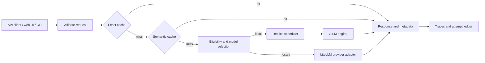

# AdaRoute

AdaRoute is a research prototype for routing LLM requests across local and hosted models. It exposes an OpenAI-style chat endpoint, checks exact and semantic response caches, selects an eligible model deployment, schedules a local replica, and records routing and attempt metadata. A React workbench and a terminal client use the same gateway API.

The project separates two decisions:

1. **Model selection:** characterize the request, filter deployments against constraints, and rank eligible candidates using a configurable policy.
2. **Replica selection:** choose a healthy local instance using round robin, least loaded, or an SLO-aware score. Hosted cloud models execute directly without local replica scheduling.

AdaRoute is a single-user research prototype. Configured prices, quality scores and local compute costs are estimates; benchmark results should not be interpreted as verified answer quality or invoiced savings.

## Request path



- The active model-selection path uses the [deployment catalog](adaroute/selection/catalog.py), [hard constraints](adaroute/selection/constraints.py), Pareto filtering and [configurable objectives](adaroute/selection/objectives.py). Supported policies include `adaptive`, `strongest`, `cheapest`, `static`, `latency_first`, `cost_first`, `quality_first`, and `vllm_semantic_router`.
- The `vllm_semantic_router` policy has a preview-client integration and fallback. The bundled service is an **AdaRoute heuristic**, not a demonstrated deployment of the upstream vLLM Semantic Router. See [the router service](adaroute/services/vllm_router_service.py).
- Exact lookup uses request context and provenance checks. Semantic lookup uses FastEmbed embeddings and Redis Search vector KNN when available, with an in-memory fallback. The default similarity threshold is `0.90` and can be set with `SEMANTIC_CACHE_THRESHOLD`. The embedding provider can fall back to deterministic hashing if the model is unavailable. Semantic matching is restricted to eligible standalone prompts and does not prove answer equivalence.
- Local replicas are selected with [replica schedulers](adaroute/policy/replica_selection.py). The gateway tracks in-flight requests and polls available per-engine Prometheus metrics. Retry, circuit-breaker and per-replica health logic provide bounded failure handling.

## Prerequisites

- Docker Engine with Compose and [`just`](https://github.com/casey/just).
- Python 3.9 or newer for local tooling and the CLI; the gateway image uses Python 3.11.
- For the GPU profile: a compatible NVIDIA GPU, driver and NVIDIA Container Toolkit. The three GPU engines share one GPU, so available memory and other workloads affect startup.
- Internet access for the first image, model and embedding-model downloads. Hosted providers additionally need their own credentials and access.

## Start the stack

### CPU profile

```bash
cp .env.example .env     # optional for local-only use; add provider keys if needed
just up
```

The default [Compose file](docker-compose.yml) runs the gateway, Redis Stack, the web UI and a CPU vLLM server. The default server serves `Qwen/Qwen2.5-0.5B-Instruct`; [config.yaml](config.yaml) also contains other catalog entries. Catalog records and replica labels do not by themselves start additional CPU engines: verify each advertised endpoint and model before relying on it.

### NVIDIA GPU profile

```bash
cp .env.gpu.example .env.gpu
just gpu-up
```

The GPU override uses [config.gpu.yaml](config.gpu.yaml) and starts three engine processes inside one `adaroute-vllm` container:

| Container endpoint | Model | Role |
|---|---|---|
| `vllm:7001` | `unsloth/Qwen3-0.6B-GGUF:Q4_K_M` | One Qwen3 engine |
| `vllm:7002` | `unsloth/Qwen2.5-Coder-0.5B-Instruct-128K-GGUF:Q4_K_M` | Coder replica 1 |
| `vllm:7003` | Same Qwen2.5-Coder model | Coder replica 2 |

These are container-network ports used by the gateway. The compatibility proxy listens on container port `7000` and is published on host port `7001` by default; host port `7001` is not the same as engine port `7001` inside the container. The two Coder processes have separate endpoints but share the container and GPU, so they do not provide hardware or container failure isolation. The GPU image and GGUF plugin are currently unpinned.

`just gpu-up` passes `.env.gpu` to Compose for variable interpolation. The gateway service's `env_file` is `.env`, so add hosted-provider keys to `.env` as well if the GPU gateway must call cloud providers. The examples use `GOOGLE_API_KEY`, `GROQ_API_KEY`, `COHERE_CHAT_API_KEY`, `OPENAI_API_KEY`, and optionally `HF_TOKEN`; see [.env.example](.env.example) and [.env.gpu.example](.env.gpu.example). Keep credentials out of source control.

### Check and stop

```bash
docker compose ps
curl -sS http://localhost:7000/health
just down
```

The gateway is at `http://localhost:7000`, the web workbench at `http://localhost:7070`, and the API schema at `http://localhost:7000/docs`. `/health` includes per-replica details; the overall status can be healthy while an individual replica is unavailable. Model downloads and initial engine startup can take several minutes.

## Send a request

This example requests a local, real execution, bypasses the response cache and uses a low quality floor so that the small GPU-profile models can be eligible:

```bash
curl -sS http://localhost:7000/v1/chat/completions \
  -H 'Content-Type: application/json' \
  -d '{
    "model": "general",
    "messages": [{"role": "user", "content": "Explain TCP and UDP briefly."}],
    "user_private": true,
    "execution_mode": "real",
    "quality_requirement": "low",
    "no_cache": true,
    "max_tokens": 100
  }'
```

Use `prompt` or an ordered `messages` array, and optionally set `budget`, `privacy_level`, `latency_slo`, `policy`, `scheduler`, `session_id` and `session_budget`. The request schema and defaults are in [schemas.py](adaroute/schemas.py). `stream: true` is rejected. `user_private: true` restricts eligible execution to local models; it is separate from `privacy_level`. A request can still fail if no eligible local deployment is healthy or available.

Successful responses include `choices`, `usage`, and `routing_metadata` such as the selected model, deployment, replica, cache outcome, policy, latency and attempt history. Per-attempt `source`, `is_simulated`, `finish_reason`, and `cost_state` help interpret provenance and estimated versus unknown charges. Inspect these fields instead of assuming every response was produced by a live model or that local allocations are invoices.

To test caching, omit `no_cache` or set it to `false`, send the same standalone request twice, and inspect `routing_metadata.cache_hit` and `cache_type`. A semantic hit depends on the stored entries, request compatibility, embeddings and threshold; it is not guaranteed for a particular paraphrase. Confidential/restricted requests and explicit `no_cache` requests bypass caching.

## Terminal client

Install the Python dependencies and start the CLI against the running gateway:

```bash
python3 -m pip install -e '.[dev]'
just cli
# or: python3 ui/cli/main.py http://localhost:7070
```

The CLI starts in single-query mode. Use `/history on` for multi-turn context, `/private` to toggle local-only requests, and `/diag` to inspect the last successful response. See the [CLI guide](ui/cli/README.md) for defaults and all commands.

## Tests and experiments

Run these from the repository root. The Docker recipes use the `adaroute` image; build it with `just build` or start a Compose profile first.

```bash
just test             # Docker backend and integration tests
just test-local       # host Python equivalent
just ui-test          # Vitest; requires UI dependencies
just lint             # Ruff in Docker
just lint-local        # Ruff on host
```

For UI tests on a fresh checkout, run `npm install` in `ui/` first. The suite includes component and mock tests; inspect skips and service-dependent cases rather than assuming every pass exercised live infrastructure.

| Recipe | What it runs |
|---|---|
| `just benchmark` / `just benchmark-local` | Model-policy and replica-scheduler matrix against the gateway. |
| `just benchmark-event` / `just benchmark-event-local` | Event/arrival-based matrix against the gateway. |
| `just load-test` / `just load-test-local` | Mixed request load with caching permitted. |
| `just stress-test` / `just stress-test-local` | 50 no-cache requests with higher concurrency. |
| `just benchmark-live` / `just benchmark-live-local` | Five live workload requests per model policy. |
| `just report-eval` | Small local-only policy and cache evaluation; writes a new run directory. |
| `just replica-smoke` | GPU-specific three-engine, endpoint, routing and recovery check. **It terminates one replica to test recovery.** |
| `just replica-benchmark` | Small real-model scheduler comparison; injects synthetic replica-state imbalance through the control plane. |

The general benchmark, event and load recipes write shared default files under `results/` and can overwrite previous summaries. Preserve a copy before rerunning if the old output matters. Live workloads can contact configured hosted providers, incur costs, populate caches and append ledger data. The report evaluator can fall back to a test client when the gateway is unreachable; inspect its run manifest before treating results as live. The replica benchmark sends a small sequential workload, so it is not a controlled high-concurrency performance study. Recipe exit codes do not necessarily imply all offered requests succeeded: inspect completion and failure counts.

The event runner's TTFT/TPOT and quality figures include estimates or routing proxies rather than independently measured first-token timing or graded answer quality. Compare runs only with their workload, cache state, hardware, execution mode and sample size in view.

## Configuration and project layout

| Path | Purpose |
|---|---|
| [config.yaml](config.yaml), [config.gpu.yaml](config.gpu.yaml) | Catalog, policies, privacy, prices and replica endpoints for CPU/GPU profiles. |
| [adaroute/api.py](adaroute/api.py), [schemas.py](adaroute/schemas.py) | HTTP request path and typed contract. |
| [adaroute/selection/](adaroute/selection/) | Catalog, estimation, constraints, model selection and explanations. |
| [adaroute/policy/](adaroute/policy/) | Registry and replica scheduling. |
| [adaroute/cache/](adaroute/cache/) | Exact cache, Redis backend and semantic vector lookup. |
| [adaroute/backends/](adaroute/backends/) | vLLM, hosted, OpenAI-compatible and mock adapters. |
| [adaroute/resilience/](adaroute/resilience/), [adaroute/telemetry/](adaroute/telemetry/) | Retries, circuit breakers, traces and ledger. |
| [scripts/vllm_multi_server.py](scripts/vllm_multi_server.py) | GPU-profile multi-engine launcher and supervisor. |
| [adaroute/experiments/](adaroute/experiments/), [tests/](tests/) | Workload runners, simulations and test suite. |
| [ui/](ui/), [ui/cli/](ui/cli/) | React workbench and terminal client. |

The checked-in profiles are intended for a trusted local environment: `auth_required` is false, tenant/user fields are caller supplied, and control-plane endpoints include state mutation and replica termination. Restrict network access and secure or disable administrative endpoints before exposing the system to untrusted clients. Gateway and replica state can be process-local, Redis fallback is not distributed, and model identity/metric freshness need further hardening for production use.
